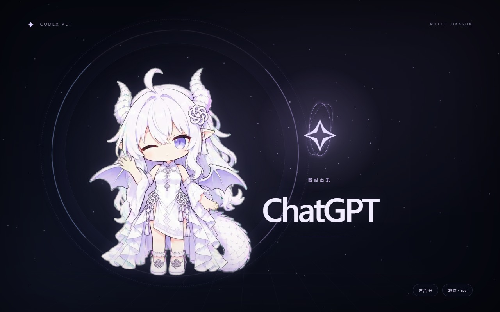
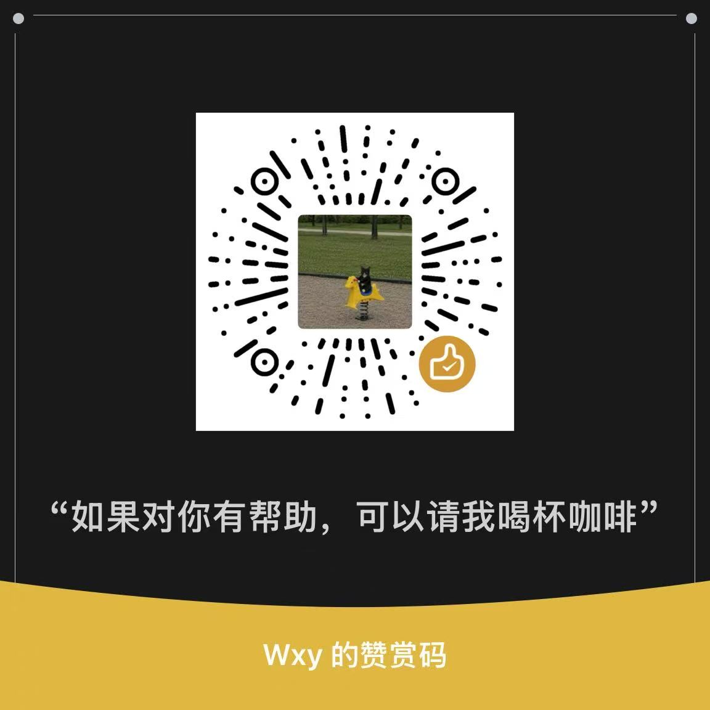

# Codex Pet

[English](README.md) | [简体中文](README.zh-CN.md)

A Windows desktop pet for Codex, WorkBuddy, and DeepSeek Harness. Pick a chibi dragon girl, Curly the sheep, or the original whale maid. They react to your tasks, wander around the desktop, and bounce when you pick them up.

Built on [dsh-pet](https://github.com/PC2005-cloud/dsh-pet), with a task list, usage display, Windows notifications, and remote conversations. Make your own character and animations, keep chat memories, or let her browse selected content. Each assistant uses its own account and capabilities.

<p>
  
  
</p>

[](https://ko-fi.com/wxy545)

## Install

Windows 64-bit. Send the matching message below to the assistant you use.

### WorkBuddy: Curly the sheep

Open WorkBuddy on Windows, sign in, and send:

```text
Install and launch this WorkBuddy desktop pet on my Windows PC: https://github.com/Wxy545/codex-pet/blob/main/INSTALL.workbuddy.md
```

The pet launches when setup finishes, with **Curly the sheep as the default**. WorkBuddy runs the installer to handle the download, runtime, task-event connection, and launch settings. You don't need to install dependencies or edit configuration files. Codex CLI is not required.

### Codex: White Dragon Girl

Install and sign in to Codex CLI first, then send this to Codex:

```text
Install and start https://github.com/Wxy545/codex-pet on Windows. Follow the repository’s INSTALL.md.
```

New Codex installations start with White Dragon Girl. Both options enable launch alongside the selected app and keep any saved character choice.

The default folder is `%LOCALAPPDATA%\codex-pet`; Git is optional. The interface follows your Windows display language: Chinese for Chinese-language systems, English for all others.

The pet starts with your selected app after installation. Use **Companion app** in the control center or tray menu to switch between Codex and WorkBuddy, or connect the [native DeepSeek Harness pet](#deepseek-harness). You can also double-click `Start Codex Pet.vbs` or `Stop Codex Pet.vbs` in the installation folder. After a manual stop, it stays stopped until the next launch of the selected app. See [INSTALL.md](INSTALL.md) for WorkBuddy setup, custom paths, and manual installation.

## Chat and tasks

In Codex mode, **double-click the pet** for a compact chat window. Switch to **Task**, choose a folder and permissions, then follow progress, cancel, or read the result in that window. Model options stay collapsed until needed, and switching between the two keeps your current content. In WorkBuddy mode, double-clicking opens WorkBuddy.

## Control center

Right-click the pet and open **Control center** to preview characters and adjust size, wandering, drag and bounce, and startup scenes. Light and dark colors follow your system. The sidebar shows the features available for your selected app.

| Feature | Codex | WorkBuddy | DeepSeek Harness |
| --- | --- | --- | --- |
| Poke, drag, wander, pick an action | Supported | Supported | Native pet |
| Task status, launch with app, completion alerts | Codex sessions | WorkBuddy tasks | Harness services |
| Task list | Desktop, pet, and remote tasks | WorkBuddy and remote tasks | Native profile's observed turns |
| Usage | Available windows, including 5-hour and weekly limits | Credits from the local client | API balance configured in Harness |
| In-pet chat, images, file tasks | Supported; tasks start read-only | Submit in WorkBuddy | Submit in Harness |
| AI chatter | Supported | Unavailable | Harness services |
| QQ and overseas remote tasks | Desktop and bridge-created conversations | Bridge-created conversations | Bridge-created conversations |

Switching apps changes the source of events, usage, and notifications. A startup theme changes the visuals only; it never changes the account or task destination. Harness uses its native plugin and manages its own settings and services.

Turn off **Show pet** in **Interactions**, or use **Hide pet** in the tray menu to hide her. Fullscreen apps, including games, hide the pet automatically by default; turn this off with **Hide during fullscreen apps**. The tray's **Show pet** brings her back. Chat, tasks, and notifications keep running while she is hidden.

The usage bar sits directly below the character. Codex shows each available window, such as **5h 81% · Week 33%**; click for reset times. WorkBuddy shows credits, and Harness shows its own API balance. The standalone pet can also show CPU, memory, and GPU usage. Unavailable readings show **—**; turn off **System monitor** in **Interactions** to hide this row.

## Task list and model defaults

Open **Task list** in the sidebar to see running tasks and items that need attention. Filter by app, source, or state; check elapsed time, the last event, and the model and reasoning effort when reported. Mark items read or snooze them. **Open source**, **Cancel**, **Result**, and **Materials** appear only when that task has the corresponding operation. Records restored after a restart are marked **Last known** rather than shown as still running.

Switch the view to **Model defaults** to choose Codex models by purpose: chat, whispers, QQ role chat, translation, summaries, image understanding, project tasks, and memory summaries. Lightweight purposes prefer an available Luna at low effort; project tasks use the account's default model with a supported high effort. The choices come from your actual model catalog. Chat and Tasks can override the model and effort for one request without changing the saved default; Chat also offers **Translate** and **Summarize**. WorkBuddy and Harness keep their own native model settings.

## Give her a poke

- **Poke:** get a bouncy reaction, a wave, or a slightly embarrassed look.
- **Pick her up:** drag her across the desktop, or give her a toss and watch her bounce.
- **Let her wander:** watch her stroll, tend to her wings, snack, or curl up for a nap. Switch to the whale maid for her Rubik’s cube and hot pot.
- **Pick an animation:** open **Control center → Actions** for the full collection. The right-click menu keeps a few quick interactions.

## While your assistant works

### Codex

- **Session status:** react to thinking, working, waiting for confirmation, completion, and errors, including across multiple local sessions.
- **Usage:** check remaining usage below the character, or open the details from the right-click menu. A missing reset time shows as unknown. If no data is available after installation, finish a reply in the main Codex chat and check again.
- **Chat and images:** open Chat from the right-click menu and send text, PNG, JPEG, or WebP images. Replies use your signed-in Codex CLI.
- **Project tasks:** open Tasks, choose a folder, describe the job, and confirm it. Tasks start in read-only mode; choose “Allow edits in this folder” when you want files changed.
- **Notifications:** switch to another app and let Windows tell you when Codex finishes, hits an error, or needs your attention.

Chat and idle chatter count toward your Codex usage. Chatter runs every ten minutes by default; change the interval or turn it off under **Chatter** in the control center.

### WorkBuddy

The pet follows WorkBuddy 5.9.3 task events: thinking, using tools, waiting for confirmation, and finishing a turn. It starts with WorkBuddy and sends completion or confirmation notifications when you are in another app.

The bar below the pet shows the current WorkBuddy personal account's remaining credits through the client's own local read-only channel. If WorkBuddy is closed, signed out, or unable to fetch credits, the balance is unavailable; it is never converted to Codex usage windows.

The pet's separate Chat (including image input), Tasks, and AI chatter remain unavailable in this mode. Submit tasks in WorkBuddy itself, or use a QQ or overseas connection below.

## Companion chat and memory

Remote messages can be either **tasks** or **companion chat**. Use `/role hello` for a character reply, or `/task your request` for a task. Set QQ's default in **Memory → QQ default mode**; each overseas connection has its own **Default message mode**. Companion chat uses a separate generator with no computer tools and the selected assistant's own account. It does not continue or create a project task.

Open **Memory** to search saved exchanges, view their original text and source, correct or delete a record, set a retention period, clear a scope, or export JSON. **View used memories** shows the excerpts selected for a reply. Originals are kept separately from the retrieval index; **Summarize for retrieval** can update that index without replacing the originals. Retrieval has a fixed context budget, and correcting or deleting a source invalidates replies still being generated from it.

Memory stays on your computer and is separated by assistant, account, connection, and character. Turn on **Share my QQ and desktop memories** to use the same memory scope for that assistant's later QQ and desktop chats; existing separate records are kept. Overseas connections remain separate. External posts and comments retain their source and are not treated as things you said.

## Tasks from QQ

Choose **Codex**, **WorkBuddy**, or **DeepSeek Harness** as the task app, then send messages from a private QQ chat. The pet shows task progress and the answer comes back to QQ, with approval prompts when needed. Keep the computer online, the selected app signed in, and Codex Pet running.

Open **QQ connection** from the pet or tray menu. Each task app and connection type keeps its own projects, conversations, permissions, pairing, and results. **Save and connect** activates the selection; only one connection runs at a time. Choosing a QQ task app does not change your desktop companion app or character.

### Use a QQ account

1. Select the task app and **QQ account**.
2. Click **Prepare connection**. Codex Pet downloads the original, checksum-verified [NapCat portable package](https://github.com/NapNeko/NapCatQQ/releases/tag/v4.18.42), about 124 MB, with its own QQ and Node runtime. Your existing QQ stays untouched. OneBot is the connection protocol; no separate installation is needed.
3. Click **Start and sign in**, scan the code, and confirm on your phone. The sign-in page opens automatically when ready.
4. Add a project folder, set **Maximum permission allowed**, and click **Save and connect**. Once connected, generate a pairing code. Add the signed-in QQ account as a friend, then send it the copied message from your own QQ in a **private chat**.

QQ controls sign-in and account checks; this connection does not bypass them.

### Use an official QQ bot

Select **Official QQ bot**, then **Create QQ bot**. Create a bot on QQ Open Platform with private-chat access, and enter its AppID and AppSecret in the local window. Add a project and permission limit, then **Save and connect**. Generate a pairing code and send the copied message privately to your bot.

| Command | Action |
| --- | --- |
| `/projects`, `/project 2` | List authorized projects or switch by number |
| `/sessions`, `/session 2` | List the selected app's conversations in this project or switch by number |
| `/sessions search name`, `/sessions next` | Find a conversation by name or open the next page |
| `/new name` | Create and name a conversation in the selected app |
| `/task 2 your request` | Send a task to the second conversation in the list |
| `/mode auto`, `/mode chat`, `/mode task` | Switch automatically or keep one profile selected |
| `/models`, `/models next`, `/model chat 2`, `/model task 1` | Codex: list available models and choose by number or full ID |
| `/effort chat low`, `/effort task high` | Codex: set a supported reasoning effort |
| `/as-chat`, `/as-task` | Run the message waiting for your choice once |
| `/permissions`, `/permissions read-only`, `/permissions edit` | View or change access within the limit set on your computer |
| `/current`, `/status` | Show the task app, project, conversation, permissions, and progress; Codex also shows the last model and effort used |
| `/cancel`, `/result`, `/help` | Cancel, retrieve a saved result, or show commands |
| `/role hello`, `/task your request` | Choose companion chat or a task for this message |
| `/pet-actions`, `/pet-character` | List current animations or characters, then select by number |
| `/pet-hide`, `/pet-show` | Hide or show the currently linked app's pet |

**Codex** supports text continuation in existing desktop conversations. Use `/new` for a new QQ conversation with file tools; Shell and MCP also use dedicated QQ conversations. Existing conversations are kept without copying or rerunning them. Auto mode is the default: everyday chat prefers an available Luna model at `low` effort, while file and code tasks prefer the account's default model at `high`; an available Astra or Sol takes priority when that default is Luna. Effort follows the model's supported levels. Local rules make this choice without another model call. Ambiguous messages with no prior context wait for `/as-chat` or `/as-task`.

Choose a fixed mode when automatic selection does not fit, or use `/task` to specify a task in auto mode. An unavailable Codex model catalog or manually selected model prompts you to choose again. Model and effort settings do not change file permissions.

**WorkBuddy and Harness** create their own native QQ conversations; they do not take over existing desktop conversations. Model and reasoning settings follow the host app. They can read and edit files, run commands, and use selected MCP servers with the permissions below. First register Harness through the [native plugin setup](harness/README.md). QQ setup prepares a separate task environment and keeps your existing settings.

### Task tool permissions

Set these separately for each app and project in **QQ connection** on your computer:

| Option | What it allows |
| --- | --- |
| File access | Read only or edit the project; approve file writes when prompted |
| Shell | Run builds, tests, and scripts; approve each complete command in QQ |
| MCP | Choose servers from the app's local configuration; approve each call and its arguments in QQ |

Shell and MCP start off. Each app keeps its own choices, and QQ commands cannot enable them. New QQ conversations can still read project files and directories with Shell off. You can also choose an existing JSON, JSONC, or TOML MCP configuration with the file picker. Listing servers does not start them; only the selected servers connect after you save. Configuration changes require a fresh review and save. `/permissions` changes file access only; `/current` shows the tool switches.

Changing tool permissions or server choices starts a new QQ conversation and keeps the old one. Codex commands retain native write and network restrictions; these do not isolate reads of files outside the project. WorkBuddy Shell requires Git Bash and runs as your current Windows user: file read-only access does not fully constrain command side effects. MCP servers use their own permissions and may change external data. The local window lists these permissions for confirmation when you first enable them.

Selecting a listed conversation continues that same conversation. Busy conversations, or those whose idle state cannot be confirmed, reject new tasks. You cannot switch projects, conversations, or permissions during a task. Codex sets model, effort, and permissions on each remote turn; those choices also affect that conversation's later defaults.

Approval messages show the operation and a one-time code. Questions include reply instructions. Failed deliveries are kept locally and show their source when retrieved from another conversation; retrieving them does not run the task again.

Only the paired QQ account can send private text commands. Group chats, self-sent messages, and non-text messages are ignored. Authorize folders on your computer and select them by number in QQ; conversation lists show names and states only. AppSecret is encrypted for your Windows account. NapCat's native configuration contains local connection tokens, so keep the installation's `data/` folder private.

## Other chat apps

Open **Chat connections** in the sidebar to add a **Telegram bot**, **Telegram account**, **Discord bot**, **LINE Official Account**, or **WhatsApp Cloud API number**. Each connection chooses Codex, WorkBuddy, or Harness and keeps its own pairing, projects, permissions, conversations, and results. After owner pairing, task messages use the same approval, cancellation, continuation, and result handling as QQ. Companion chat and task mode are selected separately for each connection.

Telegram bots use long polling; Telegram accounts sign in through the local window with an API ID and API Hash. Discord supports official bots only. LINE and WhatsApp need your own public HTTPS webhook forwarded to the pet's separate local callback listener. These five adapters have protocol tests and local UI checks, but **real overseas accounts and message delivery have not been verified**. Setup and platform-specific requirements are in [Chat connections](docs/international-chat.md).

## Characters and animations

Choose a chibi character under **Characters** in the control center:

- **White Dragon Girl:** the default for new Codex installations, with 23 chibi clips. She can read a spellbook, hug a little gem, tend to her wings, snack, or take a cushion break, alongside her walking, click and work reactions.
- **Blue whale maid:** the original dsh-pet character and its full animation set.
- **Curly the sheep:** the default for new WorkBuddy installations, with seven transparent clips for breathing, walking, a cheerful click response, thinking, typing, waiting, and waving. Error and low-quota reactions share her thinking clip.

The dragon girl has five click reactions and a second walking action with a flutter of her wings. Her idle pool covers small gestures, play, food, cooling off, and greetings. Balance and chatter events reuse suitable clips and are marked “Shared animation” in the menu. Your saved character choice is kept when updating.

The original blue whale maid retains her **106 transparent animations**. These previews are from [dsh-pet](https://github.com/PC2005-cloud/dsh-pet):

<p>
  
  
  
</p>

## Make your own pet

Open **Create** to start a character, copy a built-in one, or import a work package. Edit the name, profile, author, source, and material license. Import PNG images or sprite sheets, combine a PNG sequence, or use transparent WebM clips. Preview loops against light, dark, or checkerboard backgrounds, adjust framing and playback, then bind clips to the pet's actual action slots. **Use character** applies the checked package locally.

You can also bind recordings to greetings, clicks, work, approvals, completion, and errors, with volume and cooldown controls. Add a startup clip to a character package, or trim and arrange clips in **Startup clips**. Exported packages include the chosen media, bindings, and material license, not your chat history or memory.

To contribute, open **GitHub contributions**, connect your GitHub account, and check the file list, public profile, production notes, and license. After you confirm playback and distribution rights, **Publish contribution PR** uploads the work to your public fork and opens a PR here; larger archives use a release in that fork. You can refresh the review status from the same panel. Nothing is published merely by importing or exporting a local package.

## Content activities and AI host sessions

**Activities** connects selected content services or account APIs to bounded browsing and analysis. Domestic adapters cover Bilibili, Douyin, Xiaohongshu, Weibo, and RSS subscriptions; overseas adapters cover specific X, Reddit, YouTube, TikTok, Instagram, Pinterest, and Twitch API operations. The available feed, comments, captions, and media depend on the selected service and account permissions. This is not a universal recommendation-feed reader.

Choose a source, assistant, operations, and budget, then **Run now** or enable a read-only schedule. Likes, comments, private messages, publishing, and streaming controls require their own switches and a local confirmation for each operation. Results retain their sources and distinguish text, captions, image pixels, and unavailable material. Optional QQ sharing goes only to your paired account.

An **AI host session** can read bounded live comments, generate short replies with a separate public persona, update a selected OBS text source, and play an enabled Windows voice. Set a duration and model-call budget, then start, pause, or end the session. You prepare the stream, OBS scene, content service, and audio capture; starting the host does not itself start streaming. See [Content activities](docs/content-activities.md) for supported operations and the current verification limits, including unverified overseas accounts and live broadcasts.

## Startup and updates

New installations enable the pet and a startup scene. By default, WorkBuddy opens with Curly: a blink, a little typing, then a wave. Codex opens with the dragon-girl cinematic: eyes opening, wings unfolding, glass panels sweeping past, then a window reveal. The dragon intro lasts about 11 seconds. Both scenes have original sound effects. Use **Skip** or Esc to leave early; the sound button toggles audio.

The cinematic uses her full-size form. The desktop companions stay chibi, with no random transformations.

Open **Startup & app** in the control center, or **Startup scene** in the tray menu, to choose **Pet only**, **Startup scene only**, or **Pet and startup scene**. **Preview scene** plays it immediately. Updates keep your saved mode.

In **Control center → Startup & app → Theme & video**, choose **Follow companion app**, **ChatGPT**, **DeepSeek**, or **WorkBuddy**. DeepSeek has a blue tech-themed animation; WorkBuddy uses Curly. The theme changes the visuals; the selected companion app still receives focus when the scene ends.

Use **Import video** to add your own MP4 or WebM, then select it and preview. Videos can be up to **60 seconds, 4K, and 256 MiB**. Imported copies stay on your computer. Removing a video from the library leaves your original file untouched.



For updates, troubleshooting, or disabling launch alongside your app, ask your assistant to follow the [maintenance guide](docs/maintenance.md).

<details>
<summary>Manual settings and development</summary>

To stop the pet from launching with the selected app:

```powershell
powershell -File scripts/disable-follow.ps1
```

See [maintenance](docs/maintenance.md) for Codex and dsh-pet update checks, development setup, and troubleshooting. For a daily check, ask Codex to set up a maintenance task for your installation.

After updating the source, run `node scripts/prepare-runtime.mjs` to prepare the bundled characters and startup film. Custom skins and your saved choices are kept.

</details>

## DeepSeek Harness

Choose **Companion app → DeepSeek Harness (native plugin)** in the control center or tray menu to select an installed Harness and its profile, then install the dragon girl's 23 clips into its native dsh-pet. For Harness Desktop, open it once to initialize the profile, then fully quit it before installation. Reopen that profile afterward.

Harness 0.2.2-rc.1 needs Node.js 24.9 or newer. The installer checks the selected Harness CLI's runtime separately; Codex and WorkBuddy keep their existing requirements. Harness 0.2.1-rc.2 and rc.5 remain supported.

Harness uses its own account, sessions, balance, and chat. The bar below the pet shows its provider's API balance, credits, or available usage windows; click a window summary for reset details. Switch back to Codex or WorkBuddy from the tray or control center to restore the standalone pet and your saved character. Startup themes and imported videos currently apply to the standalone pet, not Harness's native startup page. See the [Harness guide](harness/README.md) for supported versions and manual installation.

The native task button lists turns observed in that Harness profile, with counts, elapsed time, and reported model details. It supports read/snooze and opening a conversation when the native client is connected. It does not take over or cancel existing desktop sessions. The supported CLI profiles have been checked in isolation; Harness Desktop itself remains unverified.

## Buy me a coffee

Want to see more dragon-girl animations? You can help fund the video work through [Ko-fi](https://ko-fi.com/wxy545) or the WeChat code below. If you have already made an animation, share it in an [Issue](https://github.com/Wxy545/codex-pet/issues) and I’ll adapt it for the pet. See the [animation guide](docs/animation-contributions.md) for specs.

<details>
<summary>WeChat support</summary>



</details>

## Credits and license

This adaptation uses `dsh-pet@0.4.9` and retains the fixes for submenus, desktop canvas alignment, lingering tooltips, and video transparency. Thanks to the upstream project for the desktop pet, animations, and interactions. [PC2005-cloud/dsh-pet](https://github.com/PC2005-cloud/dsh-pet)

Startup scenes draw on ideas from [884048454/codex-startup-animation](https://github.com/884048454/codex-startup-animation), [yushua0808-cpu/dragon-codex-boot](https://github.com/yushua0808-cpu/dragon-codex-boot), and [linke-e/dsh-opening-animation](https://github.com/linke-e/dsh-opening-animation). Thanks also to [jingh12312-rgb/bailong-desktop-pet](https://github.com/jingh12312-rgb/bailong-desktop-pet) for desktop interaction ideas. This project uses its own dragon clips and startup visuals.

The original “溟月” character is by [上善无形](https://space.bilibili.com/4456176); the DeepSeek whale-maid design is by [ZipZipPipe](https://space.bilibili.com/4168597).

The white dragon girl is used with the creator's permission, credited as Xiaohongshu ID **233534463**. Her character assets have [separate terms](assets/white-dragon/NOTICE.md) from the code license.

Curly's AI-created character reference was supplied by **Wxy545**, who authorized its use and distribution with Codex Pet. Her clips have their own [asset notice](assets/curly-sheep/NOTICE.md).

dsh-pet 0.4.9 also depends on Edge TTS 1.9.1 (GPL-3.0-only). Its source and license are separate from this project’s MIT code. [Edge TTS source and license](THIRD_PARTY_NOTICES.md#edge-tts-语音依赖)

This project’s code and documentation use the [MIT license](LICENSE). The original animations retain dsh-pet’s noncommercial terms, and the whale character uses [CC BY-NC-SA 4.0](https://creativecommons.org/licenses/by-nc-sa/4.0/). Full credits and terms are in [third-party notices](THIRD_PARTY_NOTICES.md).

QQ account support uses an independently written OneBot adapter. [NapCat](https://github.com/NapNeko/NapCatQQ/tree/v4.18.42) is downloaded unmodified from its official release and follows its own noncommercial [Limited Redistribution License](https://github.com/NapNeko/NapCatQQ/blob/v4.18.42/LICENSE), separate from this project's MIT code.

## Contribute

Found a bug? Open an [Issue](https://github.com/Wxy545/codex-pet/issues) with your Windows version, the selected app and its version, and the steps to reproduce it. For code contributions, security reports, and release notes, see [CONTRIBUTING.md](CONTRIBUTING.md), [SECURITY.md](SECURITY.md), and [CHANGELOG.md](CHANGELOG.md).
