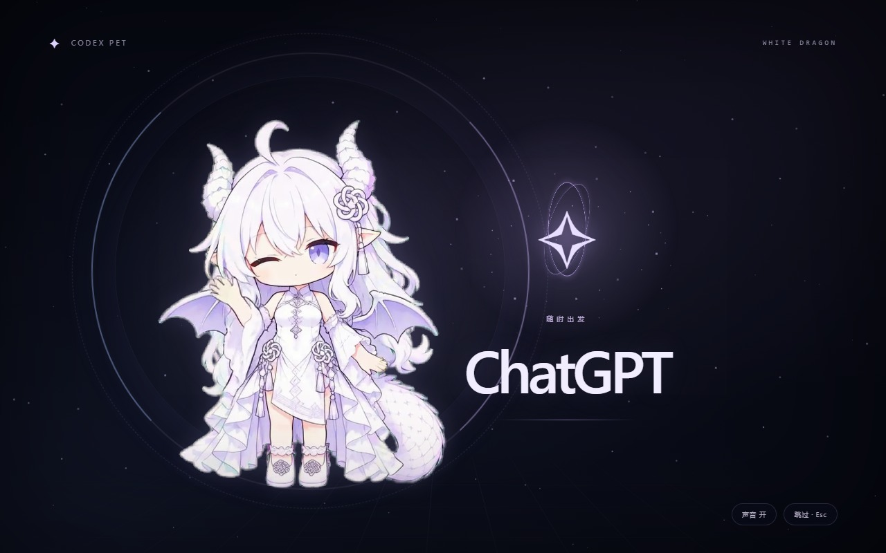
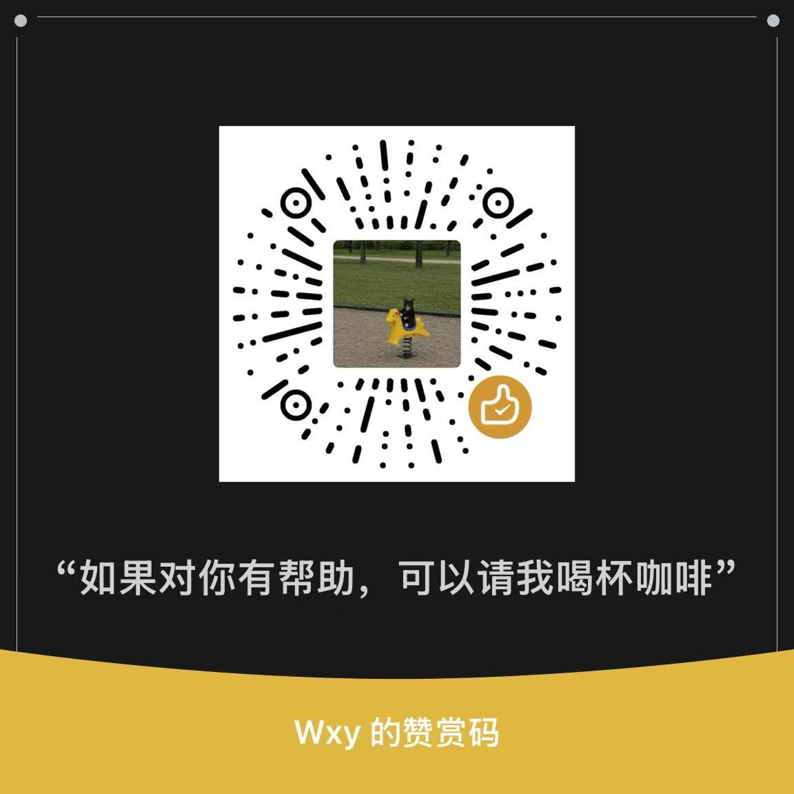

# Codex Pet

[English](README.md) | [简体中文](README.zh-CN.md)

陪你用 Codex 和 WorkBuddy 干活的 Windows 桌宠。白龙娘、卷卷小羊、大肥鱼三只 Q 版角色可随时切换，会跟着任务换动作，也会在桌面散步、打招呼；戳一下有回应，拎起来还能甩抛反弹。

基于 [dsh-pet](https://github.com/PC2005-cloud/dsh-pet)，接入任务状态、桌面互动和 Windows 通知。Codex 模式还提供额度快照、图片对话和文件任务。

<p>
  
  
</p>

[](https://ko-fi.com/wxy545)

## 安装

支持 Windows 64 位。选择你正在使用的助手，把对应的一句话发给它即可。

### WorkBuddy：默认卷卷小羊

在已安装并登录的 Windows 版 WorkBuddy 中发送：

```text
帮我下载安装并启动这个 WorkBuddy 桌宠：https://github.com/Wxy545/codex-pet/blob/main/INSTALL.workbuddy.md
```

装好后自动启动，**默认显示卷卷小羊**。下载、运行环境、事件联动和跟随启动由 WorkBuddy 调用安装器完成，用户不用手工安装依赖或修改配置，也无需安装 Codex CLI。

### Codex：默认白龙娘

先安装并登录 Codex CLI，再把这句话发给 Codex：

```text
帮我安装并启动 https://github.com/Wxy545/codex-pet，按仓库的 INSTALL.md 操作。
```

Codex 新安装默认白龙娘。两种安装方式都会开启跟随启动，已有形象选择保留。

默认安装到 `%LOCALAPPDATA%\codex-pet`，不需要预装 Git。界面跟随 Windows 显示语言：中文系统使用中文，其他语言使用英文。

安装后默认跟随所选应用启动。右键「联动应用」可在 Codex 和 WorkBuddy 之间切换。也可以在安装目录双击 `Start Codex Pet.vbs` 启动，双击 `Stop Codex Pet.vbs` 停止。手动停止后，等下次启动所选应用再跟随启动。WorkBuddy 接入、自定义目录和手动安装见 [INSTALL.md](INSTALL.md)。

## 戳戳她，或者拎起来

- **戳一下**：Q 弹回应、开心挥手，也可能害羞或鼓起脸。
- **拎起来**：拖到桌面另一边，或者甩出去，看她落地反弹。
- **随便逛逛**：散步、整理翅膀、吃零食、抱尾打盹。切到大肥鱼，还能看她玩魔方、吃火锅。
- **点播动作**：右键打开动作菜单，挑一段想看的。

## 跟着助手开工

### Codex

- **任务状态**：思考、工作、等待确认、完成和出错时切换动作，同时开着多个会话也能用。
- **额度气泡**：右键查看 Codex 已用额度和重置时间；未提供重置时间时显示“未知”。刚装好还没有数据时，在 Codex 主聊天完成一次回复后再看。
- **聊两句**：右键打开对话，可以发文字，也可以附上 PNG、JPEG 或 WebP 图片。回复使用本机已登录的 Codex CLI。
- **处理项目文件**：右键打开操作任务，选择目录、填写要做的事，再确认执行。默认只读，需要改文件时选择允许修改所选目录。
- **做完叫你**：切去做别的事，Codex 完成任务、出错或需要确认时，通过 Windows 通知提醒你。

聊天和碎碎念会使用你的 Codex 额度。碎碎念默认十分钟一次，可在 AI 设置里调整或关闭。

### WorkBuddy

桌宠接收 WorkBuddy 5.9.3 的思考、工具执行、等待确认和完成事件，跟随 WorkBuddy 启动；切到其他应用时，任务完成或需要确认会弹 Windows 通知。

聊天和新任务直接在 WorkBuddy 中提交。桌宠内的聊天（含图片输入）、文件任务、额度和 AI 碎碎念入口在此模式下隐藏。

## 形象与动画

右键打开「形象」切换 Q 版角色：

- **白龙娘**：Codex 新安装的默认角色，提供 23 段 Q 版视频。除了散步、点击和工作状态，还会抱书阅读、护住小宝石、整理龙翼、吃星形饼干、坐垫歇息、抱尾小憩。
- **大肥鱼**：保留原版角色及完整动作。
- **卷卷小羊 Curly**：WorkBuddy 新安装的默认角色，提供 7 段透明动画，会呼吸眨眼、迈小步、开心回应、托腮思考、敲键盘、合手等待和挥手招呼。出错与低额度状态共用思考动画。

龙娘有五种点击回应，散步之外还能振翼踏步。日常动作覆盖小动作、玩耍、吃东西、纳凉和招呼五类；额度与碎碎念会复用相应视频，菜单中标为「共用动作」。更新时保留已经保存的角色选择。

原版蓝色鲸鱼女仆保留 **106 段透明动画**。下面的预览来自 [dsh-pet](https://github.com/PC2005-cloud/dsh-pet)：

<p>
  
  
  
</p>

## 启动与更新

新安装默认同时开启桌宠和启动演出。启动所选应用时，会播放约 11 秒的龙娘姐姐电影：睁眼、镜头拉远、展翼、玻璃前景掠过，再由窗口揭幕交回 Codex 或 WorkBuddy。配有同步原创音效，可用「跳过」或 Esc 提前结束，右下角可切换声音。

姐姐形象用于启动电影，桌宠继续使用 Q 版，不会随机变身。

右键或托盘菜单打开「启动演出」，可选「仅桌宠」「仅启动演出」「桌宠与启动演出」；「预览演出」可立即查看。更新时保留已经保存的模式。



需要关闭跟随启动、更新或排查问题时，可以让当前助手按[维护文档](docs/maintenance.md)处理。

<details>
<summary>手动设置与源码维护</summary>

关闭跟随启动：

```powershell
powershell -File scripts/disable-follow.ps1
```

Codex 和 dsh-pet 的更新检查、源码运行及故障排查见[维护文档](docs/maintenance.md)。需要定时检查时，可以让 Codex 为你的安装设置每日维护任务。

更新源码后运行 `node scripts/prepare-runtime.mjs`，准备内置角色包和启动电影；自定义皮肤与已经保存的选择保留。

</details>

## DeepSeek Harness

龙娘的 23 段 Q 版动画也可以[安装为 DeepSeek Harness 插件](harness/README.md)，通过原生 dsh-pet 跟随 Harness 会话、余额和聊天。安装步骤与 profile 选择见插件说明。

## 请我喝杯咖啡

想让龙娘有更多动作，可以通过 [Ko-fi](https://ko-fi.com/wxy545) 或下方微信赞赏码支持视频制作。你也可以在 [Issue](https://github.com/Wxy545/codex-pet/issues) 发来已经生成好的动作视频，我来适配进桌宠。投稿规格见[动画投稿说明](docs/animation-contributions.md)。

<details>
<summary>微信赞赏</summary>



</details>

## 致谢与许可

感谢 [PC2005-cloud/dsh-pet](https://github.com/PC2005-cloud/dsh-pet) 提供桌宠、动画与互动实现。本项目基于 `dsh-pet@0.3.8` 适配。

启动演出参考了 [884048454/codex-startup-animation](https://github.com/884048454/codex-startup-animation) 和 [yushua0808-cpu/dragon-codex-boot](https://github.com/yushua0808-cpu/dragon-codex-boot) 的启动与窗口交接思路，桌宠交互也参考了 [jingh12312-rgb/bailong-desktop-pet](https://github.com/jingh12312-rgb/bailong-desktop-pet)。感谢这些项目的作者；本项目使用自制的龙娘动作与启动画面。

原型“溟月”出自 [上善无形](https://space.bilibili.com/4456176)，DeepSeek 版女仆鲸鱼娘设计出自 [ZipZipPipe](https://space.bilibili.com/4168597)。

白龙娘形象已获原作者许可，参考图署名为小红书号 **233534463**；角色素材遵循[独立许可说明](assets/white-dragon/NOTICE.md)。

卷卷小羊的 AI 参考图由 **Wxy545** 提供，已同意本项目使用并公开分发，动画制作与许可见[小羊素材说明](assets/curly-sheep/NOTICE.md)。

项目自有代码和文档采用 [MIT](LICENSE)，原版动画等素材遵守上游非商用约定，鲸鱼娘形象采用 [CC BY-NC-SA 4.0](https://creativecommons.org/licenses/by-nc-sa/4.0/)。完整来源与许可见 [THIRD_PARTY_NOTICES.md](THIRD_PARTY_NOTICES.md)。

## 参与维护

遇到问题，欢迎到 [Issues](https://github.com/Wxy545/codex-pet/issues) 留下 Windows 版本、当前联动应用及其版本和复现步骤。代码贡献见 [CONTRIBUTING.md](CONTRIBUTING.md)，安全问题见 [SECURITY.md](SECURITY.md)，版本变化见 [CHANGELOG.md](CHANGELOG.md)。
