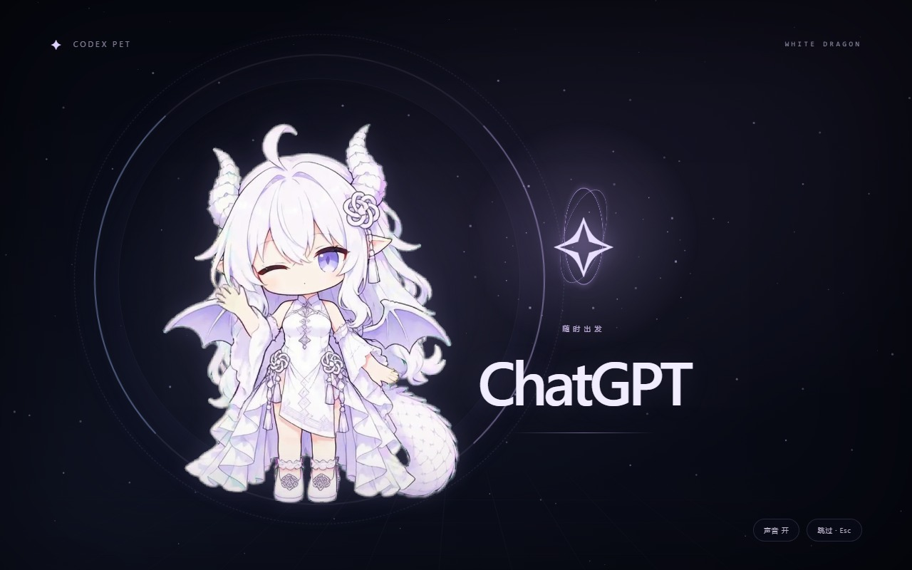
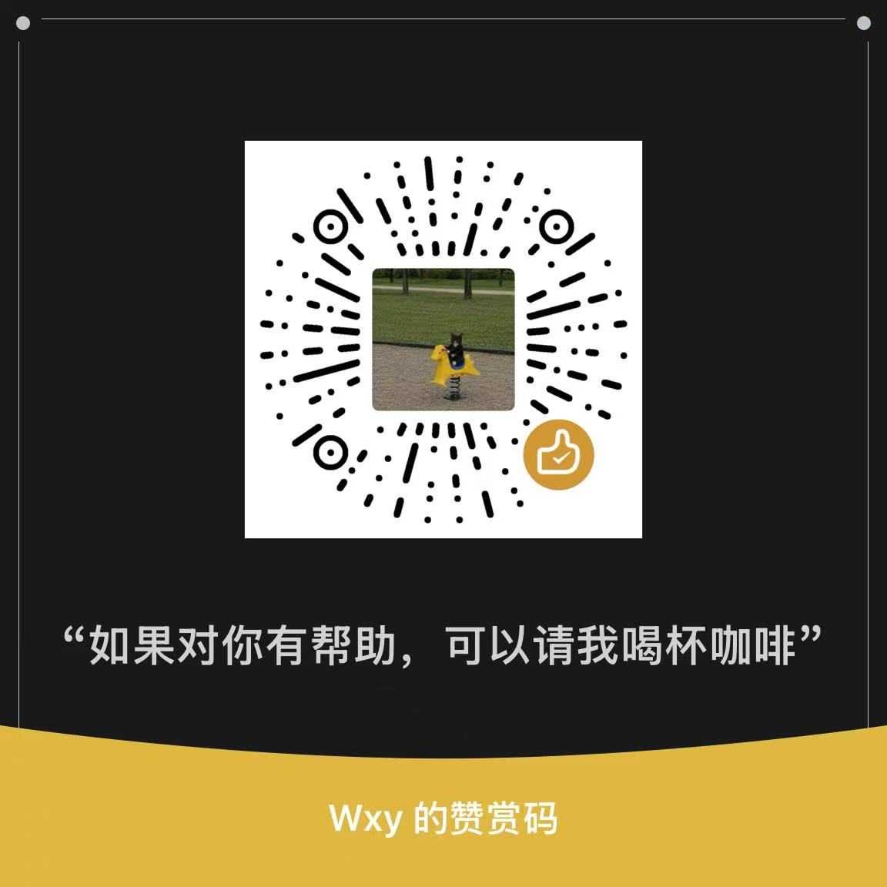

# Codex Pet

[English](README.md) | [简体中文](README.zh-CN.md)

陪你用 Codex、WorkBuddy 和 DeepSeek Harness 干活的 Windows 桌宠。白龙娘、卷卷小羊、大肥鱼三只 Q 版角色可随时切换，会跟着任务换动作，也会在桌面散步、打招呼；戳一下有回应，拎起来还能甩抛反弹。

基于 [dsh-pet](https://github.com/PC2005-cloud/dsh-pet)，接入任务列表、额度、Windows 通知和远程聊天。也可以自己制作角色和动作、管理角色记忆，或让她按设定浏览内容、回应直播弹幕。不同助手使用各自的账号与能力。

<p>
  
  
</p>

[](https://ko-fi.com/wxy545)

## 安装

支持 Windows 64 位。选择你正在使用的助手，把对应的一句话发给它即可。

### WorkBuddy：默认卷卷小羊

在已安装并登录的 Windows 版 WorkBuddy 中发送：

```text
帮我下载安装并启动这个 WorkBuddy 桌宠：https://github.com/Wxy545/codex-pet/blob/main/INSTALL.workbuddy.md
```

装好后自动启动，**默认显示卷卷小羊**。下载、运行环境、事件联动和跟随启动由 WorkBuddy 调用安装器完成，用户不用手工安装依赖或修改配置，也无需安装 Codex CLI。

### Codex：默认白龙娘

先安装并登录 Codex CLI，再把这句话发给 Codex：

```text
帮我安装并启动 https://github.com/Wxy545/codex-pet，按仓库的 INSTALL.md 操作。
```

Codex 新安装默认白龙娘。两种安装方式都会开启跟随启动，已有形象选择保留。

默认安装到 `%LOCALAPPDATA%\codex-pet`，不需要预装 Git。界面跟随 Windows 显示语言：中文系统使用中文，其他语言使用英文。

安装后默认跟随所选应用启动。在控制中心或托盘的「联动应用」中可切换 Codex、WorkBuddy，或接入 [DeepSeek Harness 原生桌宠](#deepseek-harness)。也可以在安装目录双击 `Start Codex Pet.vbs` 启动，双击 `Stop Codex Pet.vbs` 停止。手动停止后，等下次启动所选应用再跟随启动。WorkBuddy 接入、自定义目录和手动安装见 [INSTALL.md](INSTALL.md)。

## 对话与任务

Codex 模式下，**双击角色**打开小输入窗，直接打字发送；点上方「任务」可选择工作目录与权限，提交后在原窗查看进度、取消和结果。两种窗口都去掉侧栏，模型选项默认收起；来回切换保留当前内容。WorkBuddy 模式下，双击打开 WorkBuddy。

## 控制中心

右键桌宠打开「控制中心」，预览和切换角色，调整大小、漫游、拖拽反弹和启动演出。界面跟随系统切换深浅配色，侧栏只显示当前联动应用支持的功能。

| 功能 | Codex | WorkBuddy | DeepSeek Harness |
| --- | --- | --- | --- |
| 点击、拖拽、漫游、动作点播 | 支持 | 支持 | 原生桌宠提供 |
| 工作状态、跟随启动、完成提醒 | Codex 会话 | WorkBuddy 任务 | Harness 原生服务 |
| 任务列表 | 桌面、桌宠与远程任务 | WorkBuddy 与远程任务 | 当前原生 profile 观察到的回合 |
| 额度 | 实际返回的五小时、周等窗口 | 本机客户端的剩余积分 | Harness 配置的 API 余额 |
| 桌宠内聊天、图片和文件任务 | 支持，任务默认只读 | 在 WorkBuddy 中提交 | 在 Harness 中提交 |
| AI 碎碎念 | 支持 | 不开放 | Harness 原生服务 |
| QQ 与海外远程任务 | 桌面会话与接入端新建会话 | 接入端新建会话 | 接入端新建会话 |

切换应用后，事件、额度和通知跟着切换；启动主题只改变画面，不改变账号或任务去向。Harness 使用原生插件，其设置和服务由 Harness 管理。

在「互动」里关闭「显示桌宠」，或从托盘菜单隐藏。游戏等应用全屏时默认自动隐藏，可关闭「全屏时自动隐藏」。需要她回来时，点托盘的「显示桌宠」。隐藏期间，聊天、任务和通知继续运行。

额度条位于角色正下方。Codex 会列出实际存在的各窗口剩余比例，例如 **5小时 81% · 周 33%**，点击可看重置时间；WorkBuddy 显示积分，Harness 显示自己的 API 余额。独立桌宠下方还可显示 CPU、内存和 GPU 使用率，读不到的项目显示 **—**，可在「互动」里关闭「系统监控」。

## 任务列表与模型用途

侧栏的「任务列表」集中显示运行中和待处理任务，可以按应用、来源、状态筛选，查看耗时、最近事件，以及实际返回的模型和思考档位。记录可以标为已读或稍后提醒；只有该任务提供对应操作时，才显示「打开来源」「取消」「查看结果」「查看材料」。重启后恢复的记录标为「上次记录」，不冒充仍在执行。

切换到「模型用途」，可以分别设置 Codex 的闲聊、碎碎念、QQ 角色聊天、翻译、内容总结、图片理解、操作任务和记忆整理用哪个模型。轻量用途默认优先可用 Luna 的低强度，操作任务使用账号默认模型及其支持的高强度；可选项以真实模型目录为准。对话和任务输入也能单次指定模型与强度，不改已保存的默认值；对话另有「翻译」「总结」用途。WorkBuddy、Harness 沿用各自应用的模型设置。

## 戳戳她，或者拎起来

- **戳一下**：Q 弹回应、开心挥手，也可能害羞或鼓起脸。
- **拎起来**：拖到桌面另一边，或者甩出去，看她落地反弹。
- **随便逛逛**：散步、整理翅膀、吃零食、抱尾打盹。切到大肥鱼，还能看她玩魔方、吃火锅。
- **点播动作**：在「控制中心 → 动作」里挑一段想看的，右键只保留少量常用互动。

## 跟着助手开工

### Codex

- **任务状态**：思考、工作、等待确认、完成和出错时切换动作，同时开着多个会话也能用。
- **额度**：角色脚下查看剩余额度，也可从右键菜单打开详情；未提供重置时间时显示“未知”。刚装好还没有数据时，在 Codex 主聊天完成一次回复后再看。
- **聊两句**：右键打开对话，可以发文字，也可以附上 PNG、JPEG 或 WebP 图片。回复使用本机已登录的 Codex CLI。
- **处理项目文件**：右键打开操作任务，选择目录、填写要做的事，再确认执行。默认只读，需要改文件时选择允许修改所选目录。
- **做完叫你**：切去做别的事，Codex 完成任务、出错或需要确认时，通过 Windows 通知提醒你。

聊天和碎碎念会使用你的 Codex 额度。碎碎念默认十分钟一次，可在控制中心的「碎念」里调整或关闭。

### WorkBuddy

桌宠接收 WorkBuddy 5.9.3 的思考、工具执行、等待确认和完成事件，跟随 WorkBuddy 启动；切到其他应用时，任务完成或需要确认会弹 Windows 通知。

脚下额度条显示 WorkBuddy 当前个人账户的剩余积分，使用客户端自己的本机只读通道；客户端未启动、未登录或查询失败时显示未知，不折算成 Codex 的额度窗口。

桌宠独立的对话（含图片输入）、操作任务和 AI 碎碎念仍不开放。任务可以直接在 WorkBuddy 中提交，也可以使用下面的 QQ 或海外连接。

## 角色聊天与记忆

远程消息可以选择「执行任务」或「角色闲聊」。发送 `/角色 你好` 只让角色回复，发送 `/任务 要做的事` 则交给任务引擎。QQ 的默认模式在「记忆 → QQ 默认模式」里设置；海外连接各自选择「消息默认处理」。角色聊天使用所选助手自己的账号和独立的无工具生成器，不创建或续接项目任务。

打开「记忆」，可以搜索历史交流、查看原文与来源、纠正或删除记录、设置保存期限、清空范围，也可以导出 JSON。「查看使用片段」显示回复选用了哪些资料。原文与检索索引分别保存，「用模型整理索引」只更新检索内容，不替换原文。每次取用的上下文有固定上限；生成期间纠正或删除来源，旧回复也会失效。

记忆只保存在本机，按应用、账号、连接和角色分开。开启该应用的「本人 QQ 与桌面共用记忆」后，后续两端聊天使用同一范围，原先分开的记录仍保留；海外连接继续独立。外部帖文和评论保留来源，不会当成你说过的话。

## 在 QQ 里下任务

任务应用可选 **Codex、WorkBuddy 或 DeepSeek Harness**。手机私聊发消息，桌宠跟着任务换动作，答复和确认请求回到 QQ。电脑需要保持开机、联网，所选应用已登录，桌宠正在运行。

从桌宠或托盘打开「QQ 连接」。每种任务应用和连接方式分别保存项目、会话、权限、本人绑定及结果；点击「保存并连接」才切换，一次只运行一个连接。选择 QQ 的任务应用不会改变本机桌宠正在联动的应用或角色。

### 用普通 QQ 小号

1. 选择任务应用和「普通 QQ 小号」。
2. 点击「准备连接」，自动下载并校验约 124 MB 的 [NapCat 官方便携包](https://github.com/NapNeko/NapCatQQ/releases/tag/v4.18.42)，包内自带 QQ 和 Node，不改电脑上原有的 QQ。OneBot 是连接协议，不用另装软件。
3. 点击「启动并扫码登录」，登录页准备好后会自动打开。扫码并在手机上确认。
4. 添加项目文件夹、设置「允许的最高权限」，点击「保存并连接」。连接成功后生成配对码，把已登录的小号加为好友，再用自己的 QQ **私聊发给小号**。

扫码登录和账号风控由 QQ 决定，接入不会绕过这些限制。

### 用 QQ 官方机器人

选择「QQ 官方机器人」，点击「创建 QQ 机器人」。在 QQ 开放平台创建并开通私聊权限后，把 AppID 和 AppSecret 填进本机窗口。添加项目和权限上限，点击「保存并连接」，再将生成的配对消息私聊发给机器人。

| 命令 | 用法 |
| --- | --- |
| `/项目`、`/项目 2` | 列出授权项目，按编号切换 |
| `/会话`、`/会话 2` | 列出所选应用在当前项目的会话，按编号切换 |
| `/会话 搜索 名称`、`/会话 下一页` | 按名称查找、翻页 |
| `/新建 名称` | 在所选应用中创建并命名会话 |
| `/任务 2 要做的事` | 将任务发给会话列表中的第 2 项 |
| `/模式 自动`、`/模式 聊天`、`/模式 任务` | 自动分档或固定使用聊天、任务档 |
| `/模型`、`/模型 下一页`、`/模型 聊天 2`、`/模型 任务 1` | Codex：查看可用模型，按编号或完整模型 ID 选择 |
| `/思考 聊天 low`、`/思考 任务 high` | Codex：设置模型支持的思考档位 |
| `/按聊天`、`/按任务` | 执行刚才等待选择的消息一次 |
| `/权限`、`/权限 只读`、`/权限 编辑` | 查看或调整当前权限，不超过本机授权上限 |
| `/当前`、`/状态` | 查看任务应用、项目、会话、权限和进度；Codex 还显示最近实际使用的模型和思考档位 |
| `/取消`、`/结果`、`/帮助` | 取消任务、取回保留结果、查看命令 |
| `/角色 你好`、`/任务 要做的事` | 单条消息选择角色闲聊或执行任务 |
| `/动作`、`/形象` | 查看当前动作或角色，再按编号点播、切换 |
| `/隐藏`、`/显示` | 隐藏或显示当前联动应用的桌宠 |

**Codex** 支持已有桌面会话的文字续聊。文件任务请用 `/新建` 创建新版 QQ 会话，开启 Shell 或 MCP 后也使用 QQ 专用会话；旧会话保留，不会复制或重做。默认自动分档：日常聊天优先账号实际可用的 Luna 和 `low`，没有 Luna 则使用账号默认模型；文件和代码任务优先默认模型及 `high`，默认是 Luna 时改选可用的 Astra 或 Sol。思考档位以模型实际支持为准。分类只用本机规则，不另发模型请求；没有上下文、无法判断的消息会让你选择 `/按聊天` 或 `/按任务`。

自动判断不合适时可切固定模式；自动模式下也可用 `/任务` 明确指定任务。Codex 模型目录不可用或手选模型失效时，会提示重新选择。模型和思考设置不改变文件权限。

**WorkBuddy 和 Harness** 使用从 QQ 新建的原生会话，不接管已有桌面会话；模型和思考强度遵循各自应用的设置。除了文件读写，也可以按下面的设置执行命令、使用 MCP。Harness 请先按[原生插件说明](harness/README.md)完成安装登记，QQ 设置会准备独立的任务环境，保留原有配置。

### 任务工具权限

在电脑的「QQ 连接」中，为每个应用和项目分别设置：

| 选项 | 用途 |
| --- | --- |
| 文件权限 | 只读或可修改项目；文件写入按提示确认 |
| Shell | 执行构建、测试、脚本等命令，每次在 QQ 确认完整命令 |
| MCP | 读取该应用的本机服务配置，勾选允许使用的服务，每次调用在 QQ 确认参数 |

Shell、MCP 默认关闭，三个应用各自保存，QQ 命令不能自行开启。关闭 Shell 后，新版 QQ 会话仍可读取项目文件和目录。MCP 也可通过文件选择器选择已有的 JSON、JSONC 或 TOML 配置；只读取服务目录，保存授权后才连接所选服务。来源或内容变更后需重新选择并保存。`/权限` 只调整文件权限，`/当前` 可查看工具开关。

开启工具或更换服务后会使用新的 QQ 会话，旧会话仍保留。Codex 命令保留原生的写入和网络限制，但不保证隔离项目外文件读取。WorkBuddy 的 Shell 需要 Git Bash，按当前 Windows 用户权限执行；文件「只读」不能完整限制命令的副作用。MCP 使用服务自己的访问权限，也可能修改外部数据。首次开启时，本机窗口会列出这些权限供确认。

选中列表会话后，消息会接着原会话执行。执行中或无法确认空闲的会话暂不接新任务；任务运行时不能切换项目、会话或权限。Codex 每轮远程任务设置的模型、思考和执行权限，也会影响该会话后续回合的默认值。

审批消息带有完整操作内容和一次性确认码；需要补充信息时按提示回答。投递失败的结果会留在本机，跨会话取回时标明来源；取回结果不会重新执行任务。

连接只接受已配对的本人 QQ 私聊文字，群消息、自发消息和非文字消息均不接入任务。项目目录由电脑端授权，QQ 通过列表编号选择；会话列表只显示名称和状态。AppSecret 使用当前 Windows 账号加密保存。NapCat 原生配置含本机连接令牌，安装目录的 `data/` 不要分享。

## 其他聊天工具

侧栏打开「海外连接」，可以添加 **Telegram 机器人、Telegram 普通账号、Discord 机器人、LINE 官方账号、WhatsApp Cloud API 号码**。每条连接选择 Codex、WorkBuddy 或 Harness，分别保存配对、项目、权限、会话和结果。本人配对后，任务沿用 QQ 的确认、取消、续聊和结果取回流程；角色闲聊与任务模式在每条连接里独立设置。

Telegram 机器人使用长轮询，普通号在本机输入 API ID、API Hash 后按提示登录；Discord 只支持官方机器人。LINE、WhatsApp 需要本人准备公开 HTTPS 回调，并转发到桌宠独立的本机监听地址。目前五种接入完成了协议测试和本机界面检查，**尚未登录海外真实账号，也未验证实际消息送达**。配置步骤和平台要求见[海外聊天连接](docs/international-chat.md)。

## 形象与动画

在控制中心的「角色」里切换 Q 版形象：

- **白龙娘**：Codex 新安装的默认角色，提供 23 段 Q 版视频。除了散步、点击和工作状态，还会抱书阅读、护住小宝石、整理龙翼、吃星形饼干、坐垫歇息、抱尾小憩。
- **大肥鱼**：保留原版角色及完整动作。
- **卷卷小羊 Curly**：WorkBuddy 新安装的默认角色，提供 7 段透明动画，会呼吸眨眼、迈小步、开心回应、托腮思考、敲键盘、合手等待和挥手招呼。出错与低额度状态共用思考动画。

龙娘有五种点击回应，散步之外还能振翼踏步。日常动作覆盖小动作、玩耍、吃东西、纳凉和招呼五类；额度与碎碎念会复用相应视频，菜单中标为「共用动作」。更新时保留已经保存的角色选择。

原版蓝色鲸鱼女仆保留 **106 段透明动画**。下面的预览来自 [dsh-pet](https://github.com/PC2005-cloud/dsh-pet)：

<p>
  
  
  
</p>

## 自己做一只桌宠

在「创作」里新建角色、复制内置角色，或导入作品包，编辑名字、人设、作者、来源与素材许可。支持 PNG、精灵图、PNG 序列和透明 WebM，可在棋盘格、深浅背景中检查循环、构图与播放，调整锚点、偏移、缩放，再绑定到桌宠实际的动作槽位。「使用此角色」将检查后的作品应用到本机。

招呼、点击、工作、等待确认、完成、出错都可以绑定录音，并设置音量和冷却时间。角色包可以附带启动片段；「启动片段」还可以裁切、排列本机片库。导出的作品包含所选素材、绑定和素材许可，不带聊天记录或记忆。

想投稿时，打开「GitHub 投稿」，连接自己的 GitHub，核对文件清单、公开设定、制作说明与许可。确认本机播放效果和分发权后，点击「公开投稿并创建 PR」：作品先上传到你的公开 fork，再向本仓库发起 PR；较大的压缩包放在该 fork 的 Release。面板可刷新审核状态。仅导入、导出本机作品不会发布。

## 内容活动与 AI 主播

「内容活动」可以连接指定内容服务或账号 API，按预算浏览并分析内容。国内接入覆盖 B站、抖音、小红书、微博与 RSS 订阅；海外接入提供 X、Reddit、YouTube、TikTok、Instagram、Pinterest、Twitch 的部分账号 API 操作。能取得哪些动态、评论、字幕或画面，取决于所选服务和账号权限，不代表支持所有平台的推荐流。

选好来源、助手、操作和预算后，可以「立即执行」，或开启只读定时活动。点赞、评论、私信、发布、开播与停播分别授权，每次对外操作还需本机确认。结果保留来源，区分正文、字幕、实际图像和未取得的材料；可选分享只发给已配对的本人 QQ。

「AI 主播会话」可以读取有限弹幕，用独立的公开人设生成短回复，更新选定的 OBS 文字源，并播放已开启的 Windows 系统语音。设置时长和模型调用预算后，可以开始、暂停或结束。直播账号、内容服务、OBS 场景和音频采集由本人准备，开始主播会话不会自动开始推流。支持范围及实际验收边界见[内容活动与 AI 主播](docs/content-activities.md)，海外账号、真实模型播出和直播推流仍待配置后验收。

## 启动与更新

新安装默认同时开启桌宠和启动演出。WorkBuddy 默认由卷卷小羊出场：呼吸眨眼、敲键盘、挥手。Codex 默认播放约 11 秒的龙娘姐姐电影：睁眼、镜头拉远、展翼、玻璃前景掠过，再揭开应用窗口。演出配有原创音效，可用「跳过」或 Esc 提前结束，右下角可切换声音。

姐姐形象用于启动电影，桌宠继续使用 Q 版，不会随机变身。

控制中心的「启动与联动」或托盘的「启动演出」中，可选「仅桌宠」「仅启动演出」「桌宠与启动演出」；「预览演出」可立即查看。更新时保留已经保存的模式。

在「控制中心 → 启动与联动 → 主题与视频」里，可选「跟随联动应用」、ChatGPT、DeepSeek 或 WorkBuddy。DeepSeek 使用蓝色科技演出，WorkBuddy 使用卷卷小羊。主题决定画面，播完仍回到你选定的联动应用。

也可以「导入视频」，选择自己的 MP4 或 WebM 后预览。支持最长 **60 秒、最高 4K、256 MiB** 的视频。导入副本只保存在本机；从视频库移除时，不会删除原文件。



需要关闭跟随启动、更新或排查问题时，可以让当前助手按[维护文档](docs/maintenance.md)处理。

<details>
<summary>手动设置与源码维护</summary>

关闭跟随启动：

```powershell
powershell -File scripts/disable-follow.ps1
```

Codex 和 dsh-pet 的更新检查、源码运行及故障排查见[维护文档](docs/maintenance.md)。需要定时检查时，可以让 Codex 为你的安装设置每日维护任务。

更新源码后运行 `node scripts/prepare-runtime.mjs`，准备内置角色包和启动电影；自定义皮肤与已经保存的选择保留。

</details>

## DeepSeek Harness

在控制中心或托盘选择「联动应用 → DeepSeek Harness（原生插件）」，选择已安装的 Harness 和 profile，即可将龙娘的 23 段动画接入原生 dsh-pet。桌面版先启动一次以初始化配置，再从托盘完全退出后安装；装好后重新打开该 profile。

Harness 使用自己的账号、会话、余额和聊天。脚下额度条显示服务商实际返回的 API 金额、积分或用量窗口，点击窗口摘要可看重置时间。托盘或控制中心切回 Codex、WorkBuddy 后，恢复独立桌宠和原有角色选择。启动主题与导入视频目前用于独立桌宠，尚不控制 Harness 原生启动页。兼容版本与手动安装见[插件说明](harness/README.md)。

原生任务按钮列出当前 profile 观察到的会话回合，显示数量、耗时和实际返回的模型信息，可标记已读、稍后提醒；原生客户端连接时可打开来源会话。这里不接管或取消已有桌面会话。已支持的 CLI profile 完成了隔离检查，Harness 桌面应用载体尚未实测。

## 请我喝杯咖啡

想让龙娘有更多动作，可以通过 [Ko-fi](https://ko-fi.com/wxy545) 或下方微信赞赏码支持视频制作。你也可以在 [Issue](https://github.com/Wxy545/codex-pet/issues) 发来已经生成好的动作视频，我来适配进桌宠。投稿规格见[动画投稿说明](docs/animation-contributions.md)。

<details>
<summary>微信赞赏</summary>



</details>

## 致谢与许可

感谢 [PC2005-cloud/dsh-pet](https://github.com/PC2005-cloud/dsh-pet) 提供桌宠、动画与互动实现。本项目基于 `dsh-pet@0.4.0` 适配。

启动演出参考了 [884048454/codex-startup-animation](https://github.com/884048454/codex-startup-animation)、[yushua0808-cpu/dragon-codex-boot](https://github.com/yushua0808-cpu/dragon-codex-boot) 和 [linke-e/dsh-opening-animation](https://github.com/linke-e/dsh-opening-animation) 的启动、窗口交接与本地视频管理思路，桌宠交互也参考了 [jingh12312-rgb/bailong-desktop-pet](https://github.com/jingh12312-rgb/bailong-desktop-pet)。感谢这些项目的作者；本项目使用自制的龙娘动作与启动画面。

原型“溟月”出自 [上善无形](https://space.bilibili.com/4456176)，DeepSeek 版女仆鲸鱼娘设计出自 [ZipZipPipe](https://space.bilibili.com/4168597)。

白龙娘形象已获原作者许可，参考图署名为小红书号 **233534463**；角色素材遵循[独立许可说明](assets/white-dragon/NOTICE.md)。

卷卷小羊的 AI 参考图由 **Wxy545** 提供，已同意本项目使用并公开分发，动画制作与许可见[小羊素材说明](assets/curly-sheep/NOTICE.md)。

dsh-pet 0.4.0 新增 Edge TTS 1.9.1 语音依赖，采用 GPL-3.0-only；[源码与许可](THIRD_PARTY_NOTICES.md#edge-tts-语音依赖)单独保留。

项目自有代码和文档采用 [MIT](LICENSE)，原版动画等素材遵守上游非商用约定，鲸鱼娘形象采用 [CC BY-NC-SA 4.0](https://creativecommons.org/licenses/by-nc-sa/4.0/)。完整来源与许可见 [THIRD_PARTY_NOTICES.md](THIRD_PARTY_NOTICES.md)。

普通 QQ 小号使用本项目独立编写的 OneBot 协议适配器。[NapCat](https://github.com/NapNeko/NapCatQQ/tree/v4.18.42) 在用户本机从官方发布页原样下载，按其非商用 [Limited Redistribution License](https://github.com/NapNeko/NapCatQQ/blob/v4.18.42/LICENSE) 使用，不属于本项目的 MIT 代码。

## 参与维护

遇到问题，欢迎到 [Issues](https://github.com/Wxy545/codex-pet/issues) 留下 Windows 版本、当前联动应用及其版本和复现步骤。代码贡献见 [CONTRIBUTING.md](CONTRIBUTING.md)，安全问题见 [SECURITY.md](SECURITY.md)，版本变化见 [CHANGELOG.md](CHANGELOG.md)。
